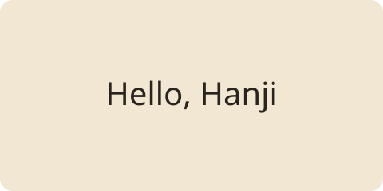

한지의 레이아웃은 `Hanji::children()`으로 컴파일된 자식 콘텐츠를 읽는다.

## 레이아웃 적용 순서

이 글은 Markdown에서 HTML로 변환한 뒤 게시글 디렉터리의 레이아웃으로 감싸고, 그 결과를 사이트 루트의 레이아웃에 전달한다.

본문의 `{{ example }}`는 Markdown 텍스트로 유지되며 Blade 코드로 실행되지 않는다.
